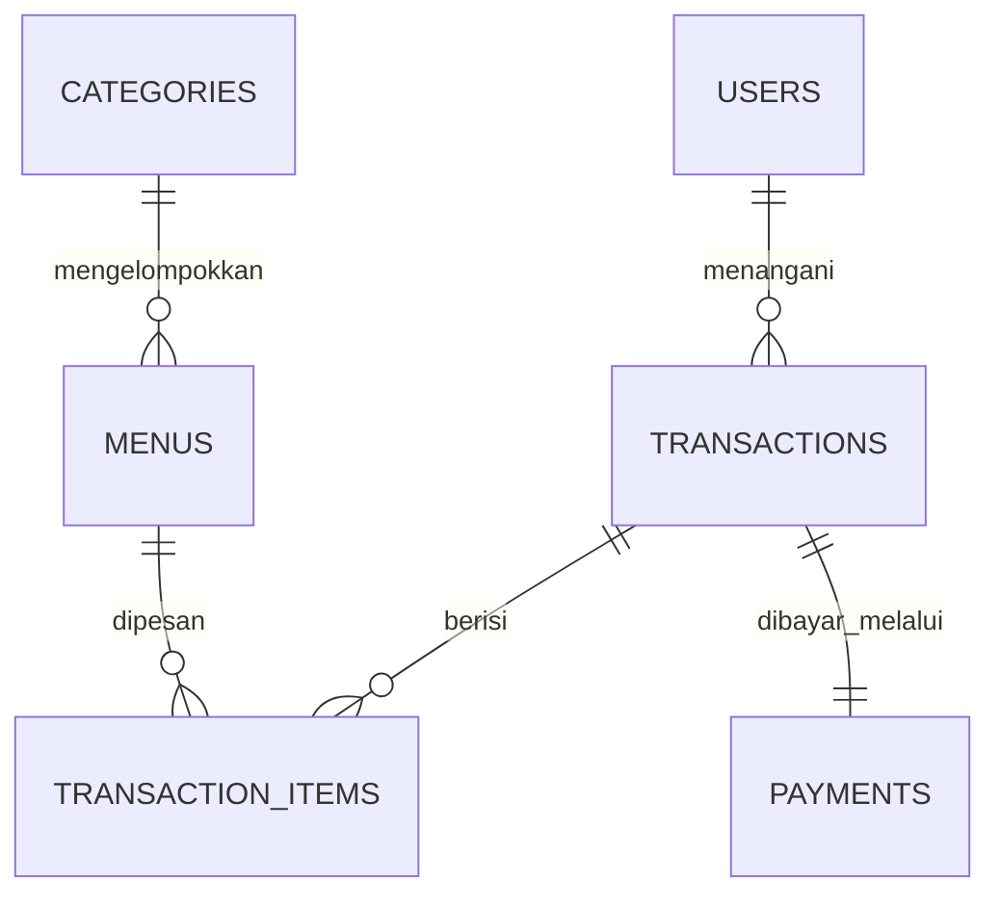

# Backend Database Schema — Warung Kikil Abang POS

Skema pada dokumen ini adalah implementasi langsung dari 7 entitas pada ERD dan atribut yang
dirinci pada Laporan Hasil Wawancara.

## 1. Ringkasan Entitas & Relasi

| Entitas | Relasi | Kardinalitas |
|---|---|---|
| Categories → Menus | satu kategori punya banyak menu | 1 – N |
| Menus → Transaction_Items | satu menu bisa dipesan di banyak baris item | 1 – N |
| Transactions → Transaction_Items | satu transaksi berisi banyak baris item (master-detail) | 1 – N |
| Users → Transactions | satu kasir menangani banyak transaksi | 1 – N |
| Transactions → Payments | satu transaksi punya satu catatan pembayaran | 1 – 1 |
| Sales_Report | entitas mandiri (hasil agregasi periodik, tanpa foreign key ke tabel lain) | — |



> **Catatan penyelarasan sumber:** Laporan wawancara mencantumkan `payment_status` sebagai
> atribut **Transactions**, sedangkan narasi DFD proses 3.4 menyebut `payment_status` ditulis
> ke **Payments**. Skema di bawah menyelesaikan ini dengan menjadikan `Transactions.payment_status`
> sebagai status bisnis yang dipakai untuk laporan (`lunas` memfilter omzet, sesuai proses 4.2),
> dan `Payments.status` sebagai status mentah dari gateway pembayaran (berguna untuk audit/log
> percobaan bayar). Backend menyinkronkan keduanya setiap kali status pembayaran berubah.

## 2. Enum

| Enum | Nilai | Dipakai di |
|---|---|---|
| `Role` | `kasir`, `pemilik` | `users.role` |
| `PaymentMethod` | `cash`, `qris` | `transactions.payment_method`, `payments.method` |
| `PaymentStatus` | `pending`, `lunas`, `gagal` | `transactions.payment_status`, `payments.status` |
| `ReportType` | `harian`, `bulanan`, `custom` | `sales_report.report_type` |

## 3. Definisi Tabel

### 3.1 `users` (D1)
| Kolom | Tipe | Keterangan |
|---|---|---|
| `id` | `UUID` PK | |
| `name` | `VARCHAR(100)` | Nama lengkap |
| `username` | `VARCHAR(50)` UNIQUE | Untuk login |
| `password` | `VARCHAR(255)` | Hash bcrypt, bukan plain text |
| `role` | `Role` | `kasir` atau `pemilik` |
| `created_at`, `updated_at` | `TIMESTAMP` | |

### 3.2 `categories` (D3)
| Kolom | Tipe | Keterangan |
|---|---|---|
| `id` | `UUID` PK | |
| `category_name` | `VARCHAR(50)` | Mis. "Nasi", "Lauk", "Minuman" |
| `created_at`, `updated_at` | `TIMESTAMP` | |

### 3.3 `menus` (D2)
| Kolom | Tipe | Keterangan |
|---|---|---|
| `id` | `UUID` PK | |
| `category_id` | `UUID` FK → `categories.id` | |
| `name` | `VARCHAR(100)` | Nama menu |
| `price` | `DECIMAL(12,2)` | Harga satuan |
| `is_available` | `BOOLEAN` default `true` | **Saklar manual** tersedia/habis, diatur pemilik/kasir — bukan hasil perhitungan stok, karena manajemen stok bahan baku sengaja di luar ruang lingkup sistem |
| `created_at`, `updated_at` | `TIMESTAMP` | |

### 3.4 `transactions` (D4)
| Kolom | Tipe | Keterangan |
|---|---|---|
| `id` | `UUID` PK | |
| `user_id` | `UUID` FK → `users.id` | Kasir yang menangani transaksi |
| `transaction_date` | `TIMESTAMP` default `now()` | |
| `total_price` | `DECIMAL(12,2)` | Dihitung ulang di backend, bukan dari input klien |
| `payment_method` | `PaymentMethod` | `cash` atau `qris` |
| `payment_status` | `PaymentStatus` default `pending` | Status bisnis, dipakai proses agregasi laporan (4.2) |
| `created_at`, `updated_at` | `TIMESTAMP` | |

### 3.5 `transaction_items` (D5)
> Pada diagram ERD asli, kotak entitas ini berlabel **"Items"**; nama tabel mengikuti
> penamaan konsisten pada DFD dan wawancara, yaitu **Transaction_Items**.

| Kolom | Tipe | Keterangan |
|---|---|---|
| `id` | `UUID` PK | |
| `transaction_id` | `UUID` FK → `transactions.id` | |
| `menu_id` | `UUID` FK → `menus.id` | |
| `quantity` | `INTEGER` | Jumlah pesanan |
| `subtotal` | `DECIMAL(12,2)` | `price` menu × `quantity` pada saat transaksi (disimpan, bukan dihitung ulang, agar riwayat tidak berubah jika harga menu diubah di kemudian hari) |

### 3.6 `payments` (D6)
| Kolom | Tipe | Keterangan |
|---|---|---|
| `id` | `UUID` PK | |
| `transaction_id` | `UUID` FK → `transactions.id`, UNIQUE | Relasi 1–1 dengan transaksi |
| `method` | `PaymentMethod` | `cash` atau `qris` |
| `amount_paid` | `DECIMAL(12,2)` | Nominal yang dibayarkan (untuk cash: uang diterima, dipakai hitung kembalian) |
| `qris_reference_number` | `VARCHAR(100)` NULLABLE | Diisi hanya untuk metode `qris` (order ID/transaction ID dari Midtrans) |
| `status` | `PaymentStatus` default `pending` | Status mentah dari proses/gateway pembayaran |
| `paid_at` | `TIMESTAMP` NULLABLE | Diisi saat status menjadi `lunas` |
| `created_at`, `updated_at` | `TIMESTAMP` | |

### 3.7 `sales_report` (D7)
| Kolom | Tipe | Keterangan |
|---|---|---|
| `id` | `UUID` PK | |
| `report_type` | `ReportType` | `harian`, `bulanan`, `custom` |
| `start_date` | `DATE` | |
| `end_date` | `DATE` | |
| `total_revenue` | `DECIMAL(14,2)` | Hanya dari transaksi berstatus `lunas` |
| `total_transactions` | `INTEGER` | |
| `total_items_sold` | `INTEGER` | |
| `generated_at` | `TIMESTAMP` default `now()` | |

> Tabel ini berfungsi sebagai **arsip/snapshot** laporan yang pernah dibuat pemilik (sesuai
> subproses 4.4 "Susun laporan" yang menuliskan hasil ke D7), sehingga laporan lama tidak
> perlu dihitung ulang. Endpoint laporan tetap bisa menghitung angka *real-time* langsung dari
> `transactions`/`transaction_items`/`payments` tanpa harus menulis ke tabel ini setiap saat
> — lihat `6-backend-api.md`.

**Statistik menu terlaris** sengaja **tidak memiliki tabel tersendiri**, sesuai catatan
eksplisit pada laporan wawancara: cukup diperoleh dari agregasi `SUM(quantity)` /
`COUNT(*)` pada `transaction_items`, dikelompokkan per `menu_id`.

## 4. Skema Prisma

```prisma
enum Role {
  kasir
  pemilik
}

enum PaymentMethod {
  cash
  qris
}

enum PaymentStatus {
  pending
  lunas
  gagal
}

enum ReportType {
  harian
  bulanan
  custom
}

model User {
  id           String        @id @default(uuid())
  name         String
  username     String        @unique
  password     String
  role         Role
  transactions Transaction[]
  createdAt    DateTime      @default(now()) @map("created_at")
  updatedAt    DateTime      @updatedAt @map("updated_at")

  @@map("users")
}

model Category {
  id           String   @id @default(uuid())
  categoryName String   @map("category_name")
  menus        Menu[]
  createdAt    DateTime @default(now()) @map("created_at")
  updatedAt    DateTime @updatedAt @map("updated_at")

  @@map("categories")
}

model Menu {
  id          String            @id @default(uuid())
  categoryId  String            @map("category_id")
  category    Category          @relation(fields: [categoryId], references: [id])
  name        String
  price       Decimal           @db.Decimal(12, 2)
  isAvailable Boolean           @default(true) @map("is_available")
  items       TransactionItem[]
  createdAt   DateTime          @default(now()) @map("created_at")
  updatedAt   DateTime          @updatedAt @map("updated_at")

  @@map("menus")
}

model Transaction {
  id              String            @id @default(uuid())
  userId          String            @map("user_id")
  user            User              @relation(fields: [userId], references: [id])
  transactionDate DateTime          @default(now()) @map("transaction_date")
  totalPrice      Decimal           @db.Decimal(12, 2) @map("total_price")
  paymentMethod   PaymentMethod     @map("payment_method")
  paymentStatus   PaymentStatus     @default(pending) @map("payment_status")
  items           TransactionItem[]
  payment         Payment?
  createdAt       DateTime          @default(now()) @map("created_at")
  updatedAt       DateTime          @updatedAt @map("updated_at")

  @@map("transactions")
}

model TransactionItem {
  id            String      @id @default(uuid())
  transactionId String      @map("transaction_id")
  transaction   Transaction @relation(fields: [transactionId], references: [id])
  menuId        String      @map("menu_id")
  menu          Menu        @relation(fields: [menuId], references: [id])
  quantity      Int
  subtotal      Decimal     @db.Decimal(12, 2)

  @@map("transaction_items")
}

model Payment {
  id                  String        @id @default(uuid())
  transactionId       String        @unique @map("transaction_id")
  transaction         Transaction   @relation(fields: [transactionId], references: [id])
  method              PaymentMethod
  amountPaid          Decimal       @db.Decimal(12, 2) @map("amount_paid")
  qrisReferenceNumber String?       @map("qris_reference_number")
  status              PaymentStatus @default(pending)
  paidAt              DateTime?     @map("paid_at")
  createdAt           DateTime      @default(now()) @map("created_at")
  updatedAt           DateTime      @updatedAt @map("updated_at")

  @@map("payments")
}

model SalesReport {
  id                 String     @id @default(uuid())
  reportType         ReportType @map("report_type")
  startDate          DateTime   @map("start_date") @db.Date
  endDate            DateTime   @map("end_date") @db.Date
  totalRevenue       Decimal    @db.Decimal(14, 2) @map("total_revenue")
  totalTransactions  Int        @map("total_transactions")
  totalItemsSold     Int        @map("total_items_sold")
  generatedAt        DateTime   @default(now()) @map("generated_at")

  @@map("sales_report")
}
```

## 5. Rekomendasi Index

| Tabel | Kolom | Alasan |
|---|---|---|
| `transactions` | `transaction_date` | Filter cepat berdasarkan rentang tanggal (laporan harian/bulanan/custom) |
| `transactions` | `payment_status` | Filter transaksi `lunas` saat agregasi omzet |
| `transaction_items` | `menu_id` | Percepat agregasi menu terlaris (`GROUP BY menu_id`) |
| `menus` | `category_id` | Percepat filter menu per kategori di layar kasir |
| `payments` | `qris_reference_number` | Pencarian cepat saat webhook Midtrans masuk |
